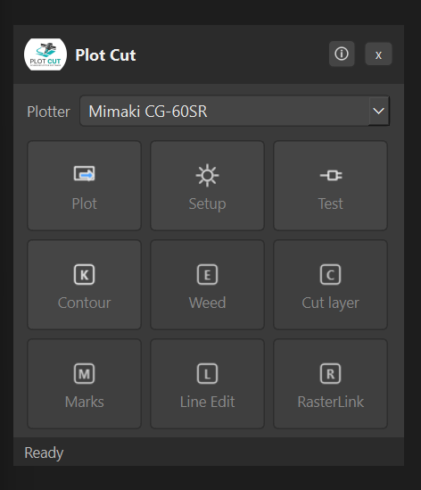
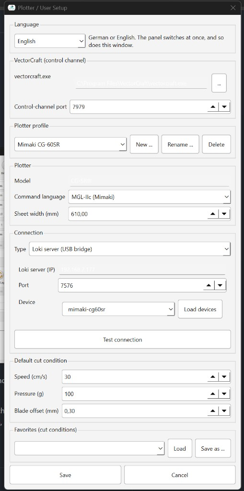
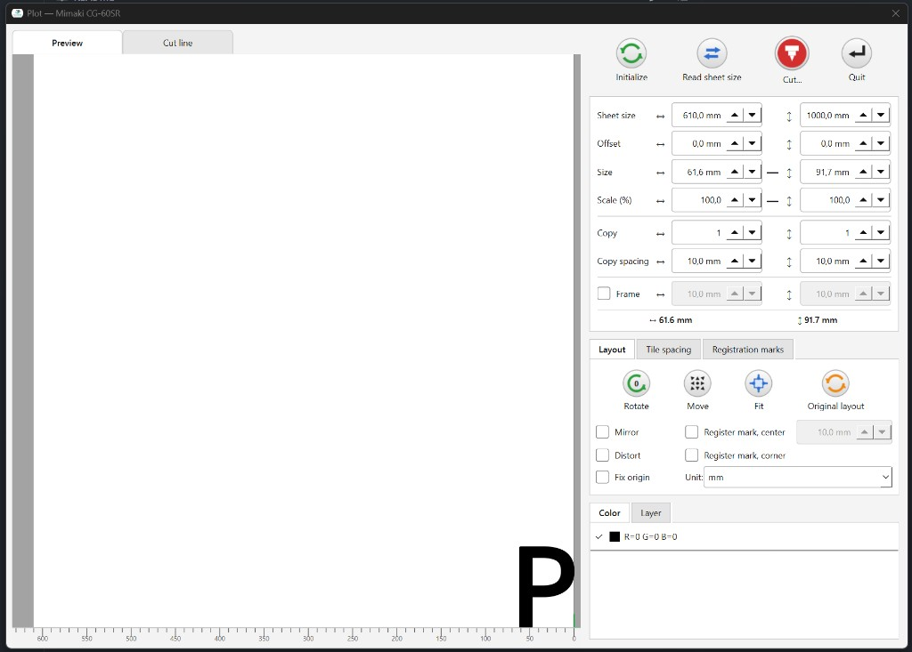

# Plot Cut

<p align="center">
  
</p>

A FineCut-style cutting panel for [VectorCraft](https://github.com/storytold/vectorcraft). It takes the current selection, shows a sheet preview, and sends MGL-IIc or HP-GL to a cutter.

Profiles included: **Mimaki CG-60SR** (MGL-IIc, origin bottom-right) and **Vevor** (HP-GL, origin bottom-left).

```
VectorCraft (--control 7979)
        │  selection as SVG
        ▼
     Plot Cut  →  cutter
```

VectorCraft plug-ins cannot draw their own panel or open a network connection, so Plot Cut is a separate always-on-top window beside the app.

On Windows with [Loki-PrintServer](https://github.com/BangerTech/Loki-PrintServer), plotting works the same way FineCut does: the Loki client attaches the cutter to this PC over USB/IP, and Plot Cut writes to the local device.

| Plotter | Attach in the Loki client | Plot Cut connection |
|---|---|---|
| Mimaki CG-60SR | USB/IP (`0a50:0001`, driver `mkusb`) | **Mimaki USB (local, like FineCut)** |
| Vevor (CH340) | USB/IP (`1a86:7523`) | **COM port**, `auto` finds the CH340 |

Illustrator and FineCut do not have to be closed. Do not send from both programs at the same time.

The Loki HTTP job API (`POST /api/plotcut/devices/{id}/job`) is still available as transport `loki`. While a cutter is attached over USB/IP, that path cannot see the device.

## Requirements

- Windows 10/11 for Mimaki USB and the Vevor COM port. The macOS and Linux builds run the panel; those two connections are the Windows setup below.
- [VectorCraft](https://getartcraft.com/apps/vectorcraft) (desktop)
- For a Mimaki or Vevor on the Pi: Loki client on this PC, cutter attached. A cutter plugged straight into this PC uses the same Setup entries, with an empty Mimaki device path or COM port `auto`.
- Python 3.12 only if you run from source (PySide6 does not support 3.14 yet)

## Getting started

End users: start **Plot Cut** (`dist\Plot Cut.exe`, or the desktop shortcut). No Python install needed.

From source:

```bat
git clone https://github.com/BangerTech/Plot-Cut.git
cd Plot-Cut
run.bat
```

`run.bat` creates a `.venv` on first run, installs dependencies, and opens the panel.

1. Start VectorCraft with the control channel: `start-vectorcraft.bat`  
   (or Plot Cut offers to launch it with `--control 7979` on the first plot)
2. Choose the plotter in the panel (Mimaki CG-60SR / Vevor)
3. Select the artwork in VectorCraft
4. If the artwork is text, or it has a stroke that should become the cut line, click **Contour** first
5. **Plot** → place the job on the sheet → **Cut...** → **Cut**

`Ctrl+Alt+P` starts **Plot** while the panel has focus. Closing the panel leaves Plot Cut in the tray. The tray menu can show the panel, start **Plot**, open **Setup**, test the connection, or quit.

Build the standalone program:

```bat
.venv\Scripts\python.exe -m PyInstaller --noconfirm "Plot Cut.spec"
```

Output: `dist\Plot Cut.exe`. The window and taskbar icon is `assets/logo.ico`.

Publishing a GitHub release builds the programs and attaches them to that release: `Plot-Cut.exe`, `Plot-Cut.dmg`, and `Plot-Cut-linux`. Mimaki USB and the Vevor COM port are the Windows setup described above.

## What the windows do

<p align="center">
  
  &nbsp;&nbsp;
  
</p>

The panel stays above VectorCraft. The plotter menu at the top switches the active profile. The status line under the tiles reports the last step.

| Tile | What it does |
|---|---|
| **Plot** | Reads the selection and opens the sheet window. |
| **Setup** | Language, VectorCraft, profiles, connection, and cut presets. |
| **Test** | Checks the VectorCraft control channel and the cutter connection. |
| **Contour** | Turns text into paths. A stroke that makes the art larger is replaced by its outer edge, and the hole in a letter stays. Nothing is sent to the cutter. Undo in VectorCraft restores the text. |
| **Weed**, **Cut layer**, **Marks**, **Line Edit**, **RasterLink** | Shown on the panel. They do not run yet. |

<p align="center">
  
</p>

**Plot** places the job. On a Mimaki the origin is the bottom-right corner and the art stays readable. On a Vevor the origin is the bottom-left. **Preview** fills closed paths, so the counter of a letter stays open. **Cut line** shows only the paths that will be cut. The mouse wheel zooms, dragging pans, and a double-click fits the art or the whole sheet.

| Control | What it does |
|---|---|
| **Initialize** | Resets this window. |
| **Read sheet size** | Copies width and length from the plotter profile. It does not ask the cutter yet. |
| **Cut...** | Opens **Output**. |
| **Quit** | Closes the window without sending. |
| Sheet size, offset, size, scale | Horizontal and vertical values. Scale stays linked until **Distort** is on. The total under the table turns red when the job is wider than the sheet. |
| **Copy**, **Copy spacing** | A grid of copies, with a gap on X and Y. |
| **Frame** | Cuts a rectangle around the art and moves the art in by that margin. |
| **Rotate** | Turns the art 90 degrees. |
| **Move** | Parks the art on one of nine places on the sheet. |
| **Fit** | Scales the art onto the sheet, keeping the proportions. |
| **Original layout** | Clears rotation, size, mirror, and position. |
| **Mirror**, **Distort**, **Fix origin** | Mirror flips the art. Distort unlocks width and height. Fix origin keeps the art on the plotter origin and turns off Move and offset. |
| **Color** | A checkmark includes that color. A cleared color is not cut. |
| **Tile spacing**, **Registration marks**, register marks, **Layer** | Visible, and not active yet. |

Placement for a document is remembered the next time that file is plotted.

**Output** is the window after **Cut...**. It does not have its own picture here.

| Control | What it does |
|---|---|
| **Plotter setting** | Sends no speed, pressure, or offset. The cutter keeps its own values. |
| **Selection setting** | Uses a preset saved in Setup. |
| **Custom** | Speed, pressure, and blade offset. Each value can be left to the cutter. |
| **Cut condition per color** | A preset for that color, **Same as plot setting**, or **Do not cut**. |
| **Sort** | **All** or **Each color**. **Inside before outside** cuts holes before the outline. |
| **Overcut** | Extends a closed path past its start so the ends meet. |
| **Park the head** | After the job, moves the head past the art by the given gap. |
| **Preview...** | Direction arrows, order numbers, and yellow travel moves. Black is counter-clockwise, red is clockwise. **Simulation** plays the cut. |
| **Save as file...** | Writes a `.plt` file and sends nothing. |
| **Save Preset Setting** | Stores the current condition under a name. |
| **Cut** | Sends the job. **Cancel** closes the window. |

## Setup / connection

Open **Setup** from the panel.

**Language** switches every label between German and English at once. Cancel restores the previous language. The plotter **command language** (MGL-IIc or HP-GL) stays separate.

**VectorCraft (control channel)** sets `vectorcraft.exe` and the port. An empty path is searched automatically. The usual port is `7979`.

**Plotter profile** can be created, renamed, and deleted. The two profiles that ship with Plot Cut are a starting point, not a fixed list. **Model**, **command language**, and **sheet width** belong to the selected profile.

**Default cut condition** is the speed, pressure, and blade offset used when no other preset is chosen. **Favorites** stores named conditions. **Load** and **Save as...** edit that list. **Test connection** checks the link from this window.

| Transport | Use when |
|---|---|
| `mimaki_usb` | Mimaki on this PC via the Loki client (recommended) |
| `serial` | Vevor or another COM plotter. `auto` picks a CH340 |
| `loki` | HTTP job API on the Pi (USB bridge, not USB/IP) |
| `tcp` | raw TCP, e.g. socat port 7580 |
| `file` | write a `.plt` file, nothing is sent |

Settings live in `%APPDATA%\PlotCut\settings.json`. Schema and internals: [`plot-cut.md`](plot-cut.md).

## Development

```bat
py -3.12 -m venv .venv
.venv\Scripts\activate
pip install -r requirements.txt
python -m plot_cut.main
```

## License

See the repository. VectorCraft is independent of Adobe. FineCut and Mimaki are trademarks of their respective owners. Plot Cut is an independent project and is not affiliated with or endorsed by Mimaki.
